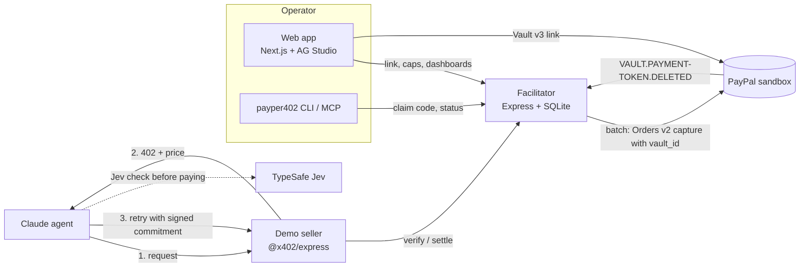

# PayPer402

**Pay-per-call for AI agents. Settled with PayPal.**

PayPer402 lets an AI agent pay for APIs one call at a time over HTTP 402 (the
[x402 protocol](https://github.com/x402-foundation/x402)), while the money moves through PayPal
instead of crypto. Think of it as electronic toll collection for APIs: link once, drive through,
get billed once.

Built for the [PayPal AI Hackathon](https://paypalaihackathon.devpost.com) (October–November 2026).

## The problem

AI agents increasingly need to buy things on their own: a market quote, a page summary, a
translation. Each one is worth a few cents. Today an agent cannot pay a few cents per call:

- API subscriptions and prepaid keys need a human to sign up for every provider in advance.
- Card and wallet checkouts need a human in the loop for every purchase.
- A per-call charge is impossible anyway: a fixed fee per transaction is larger than the call.

x402 solves the first two with `402 Payment Required`, but it settles on a blockchain. Most
operators and API sellers do not want to hold stablecoins; they already have PayPal.

## How it works

1. **Link once (a human is present).** The operator links a PayPal account with the PayPal Vault
   v3 API (`usage_pattern: UNSCHEDULED_POSTPAID`) and sets caps: per call, per day, total, and an
   unsettled cap.
2. **Pay per call (no human).** A paid API answers `402 Payment Required` with a price. The agent
   signs a payment commitment with its Ed25519 key and retries. The facilitator verifies the
   signature, the caps and replay protection, records the commitment, and the API serves the
   response.
3. **Settle in one charge (no human).** Commitments are added up and charged to the saved PayPal
   account in one PayPal Orders v2 capture, when the unsettled cap is reached or once a day. The
   charge is never more than the sum of signed, unsettled commitments.
4. **Stop at any time.** The payer can click "Stop paying with PayPal" in their PayPal account.
   The facilitator notices (webhook, health check or the next charge) and the agent's next paid
   call is refused at once.

## What is in the box

- **An x402 network binding for PayPal.** Network `paypal:sandbox`, asset `USD`, scheme
  `batch-settlement`, written as plug-ins for the official `@x402/core` SDK (client, resource
  server and facilitator). Sellers use the stock `@x402/express` middleware; nothing is forked.
  The protocol is specified in
  [docs/spec/scheme_batch_settlement_paypal.md](docs/spec/scheme_batch_settlement_paypal.md), in
  the style of the x402 scheme specs.
- **A facilitator.** It verifies commitments, keeps the ledger, enforces caps, settles batches with
  PayPal, and handles revocation.
- **A Claude agent as the protagonist.** It reads 402 prices, decides what is worth paying for
  within a budget, pays, finishes the task, and explains what it spent.
- **A decision layer.** Before each payment, Jev (TypeSafe) gives a calibrated second opinion: does
  this call serve the task, and is its result already in hand? Code decides with fixed thresholds.
- **A web app.** Demo sign-in, PayPal onboarding, caps, a live view of the agent spending, and
  operator and seller dashboards built with AG Studio, with a read-only Claude analyst inside.
- **A terminal command and an MCP server.** `payper402 onboard` connects an agent with a claim code
  from the web app. The agent's key is generated locally and never leaves the machine.
  `payper402 mcp` lets Claude Code or Claude Desktop pay per call through PayPer402.
- **A demo seller.** "Acme Data" sells four paid APIs (simulated data), priced from 1 to 25 cents.

## Use of PayPal

All calls go to the PayPal **sandbox**. The PayPal client refuses the live API host.

| PayPal API | What PayPer402 uses it for |
|---|---|
| OAuth 2.0 | Client-credentials token, cached |
| Vault v3 setup tokens | Start the one-time link (`payment_source.paypal`, `usage_type: MERCHANT`, `usage_pattern: UNSCHEDULED_POSTPAID`) |
| Vault v3 payment tokens | Exchange the approved setup token for a saved `vault_id`; check it; delete it on unlink |
| Orders v2 | Create and capture one order per batch with `payment_source.paypal.vault_id`, with `PayPal-Request-Id` for idempotency |
| Webhooks | `VAULT.PAYMENT-TOKEN.DELETED`, verified with the webhook signature API, for instant revocation |

Revocation is handled as PayPal reports it: `422 AGREEMENT_ALREADY_CANCELLED` on a charge and
`404 TOKEN_NOT_FOUND` on the token both mark the wallet as stopped. PayPal keeps one agreement per
payer and merchant, so a revocation stops every operator that shares that payment token.

## Use of AI

| Where | Model | What it does |
|---|---|---|
| Demo agent | Claude (Anthropic SDK, tool use, adaptive thinking) | Plans within a budget, discovers 402 prices, pays, answers, explains its spending |
| Decision layer | Jev `jev-1.14.0` (TypeSafe) | Probabilities that a call serves the task and that its result is already covered; thresholds come from a labelled evaluation |
| Dashboards | Claude behind a server route, in AG Studio | A read-only analyst over spend, settlements and revenue |
| Demo seller | Claude | The paid summary and translation APIs |

Payment tools never accept free-form amounts, URLs or recipients from the model: services are
named by catalog ids, and every price is checked against the catalog, the per-call limit and the
remaining budget before anything is signed.

## Architecture



| Path | What it is |
|---|---|
| `packages/scheme-paypal` | The x402 binding: client, server and facilitator plug-ins for `paypal:sandbox` |
| `packages/paypal-client` | Typed PayPal REST client (OAuth, Vault v3, Orders v2, Webhooks), sandbox only |
| `apps/facilitator` | Verify, settle, ledger, caps, settlement job, revocation, webhooks |
| `apps/demo-seller` | Four paid APIs behind `@x402/express` |
| `apps/agent` | The Claude agent, the decision layer, the MCP server and the `payper402` command |
| `apps/web` | Landing, onboarding, operator and seller consoles |
| `docs/spec` | The PayPal binding spec |
| `spikes/` | The feasibility checks run at the start: vault charging, Jev, AG Studio |

## Run it locally

Requirements: Node.js 22 or later (24 recommended), a PayPal developer account with a sandbox REST
app, and an Anthropic API key.

**1. Install.**

```bash
git clone https://github.com/kann420/PayPer402.git
cd PayPer402
npm install
cp .env.example .env
```

**2. Fill `.env`.** The minimum for the full browser demo:

| Variable | Where it comes from |
|---|---|
| `PAYPAL_CLIENT_ID`, `PAYPAL_CLIENT_SECRET` | developer.paypal.com → Apps & Credentials → Sandbox. The app's sandbox Business account must have "Save payment methods" enabled |
| `ANTHROPIC_API_KEY` | console.anthropic.com |
| `DATA_ENCRYPTION_KEY` | `node -e "console.log(require('crypto').randomBytes(32).toString('hex'))"` |
| `API_KEY_PEPPER` | `node -e "console.log(require('crypto').randomBytes(32).toString('base64url'))"` |

Optional: `TYPESAFE_API_KEY` turns the decision layer on, `ANTHROPIC_MODEL` picks the Claude model,
and `AG_STUDIO_LICENSE_KEY` removes the AG Studio watermark. Every other variable is listed with
its default in [.env.example](.env.example).

**3. Start everything.**

```bash
npm run dev:stack
```

This starts the facilitator (`:4020`), the demo seller (`:4021`) and the web app (`:3000`), seeds
the demo seller, and keeps its data in `data/`. Open <http://localhost:3000>.

**4. Walk through the story.**

1. **Sign in** with a demo account. Each visitor gets their own demo operator.
2. **Link PayPal.** Approve the link with a PayPal sandbox **Personal** account.
3. **Set limits** and create an agent.
4. **Live run.** Give the agent a task and watch it read prices, pay per call and explain its
   spending. The ledger fills up on the Overview.
5. **Charge now** (or wait for the unsettled cap). One PayPal capture settles exactly the sum of the
   calls. It shows in both sandbox accounts.
6. **Stop paying with PayPal.** In the sandbox Personal account, stop the PayPer402 automatic
   payment. The Overview shows "Stopped by payer", and the agent's next paid call is refused.
7. Switch to the **demo seller** to see revenue per endpoint and settlement status.

PayPal webhooks need a public HTTPS URL and `PAYPAL_WEBHOOK_ID`. Without them, revocation is still
noticed by the facilitator's wallet health check (every 30 seconds) and at the next charge.

### The terminal demo

The same story in one command, without the browser:

```bash
npm run demo -- --link
```

The first run prints a PayPal sandbox approval link. Later runs need no `--link`.

### Connect your own agent from a terminal

The `payper402` command runs from this clone (it is not published to npm):

```bash
npm link
```

In the web app, open Agents → New agent → "Connect from a terminal". It shows a one-time command:

```bash
payper402 onboard --claim K7QM-2XRD-9VHT --api http://localhost:4020
```

```bash
payper402 status
```

```bash
payper402 run --budget 0.50 "Brief me on today's coffee market"
```

To let Claude Code pay per call through PayPer402 (on Windows, use `cmd /c payper402 mcp`):

```bash
claude mcp add payper402 -- payper402 mcp
```

The agent's private key lives in `~/.payper402/config.json`. Treat it like a `.env` file.

## Tests

```bash
npm run typecheck
```

```bash
npm test
```

More than 1,000 Vitest tests. Every PayPal, Anthropic and TypeSafe call is mocked, so the suite
needs no credentials. The real sandbox is exercised only by explicit scripts, such as
`npm run sandbox-e2e -w apps/facilitator`.

## Safety rules

- **Sandbox only.** The PayPal client refuses `api-m.paypal.com`.
- **Never charge more than the payer signed for.** A settlement is exactly the sum of signed,
  unsettled commitments, and never more than the caps.
- **Bounded credit.** The postpaid model extends credit until settlement, so every operator has an
  unsettled cap. When it is reached the facilitator settles at once, and stops serving if that
  fails.
- **Keys stay where they belong.** Agent keys are generated on the agent's machine; the Anthropic
  key stays on the server; the stored PayPal vault ids are encrypted at rest.

## Status

A working hackathon build on the PayPal sandbox. The full flow (link, pay per call, one batch
charge, revocation) has passed end to end against the real sandbox. Not production-ready: live
PayPal credentials, payouts to many sellers and a PYUSD path are out of scope.

## License

[MIT](LICENSE)
